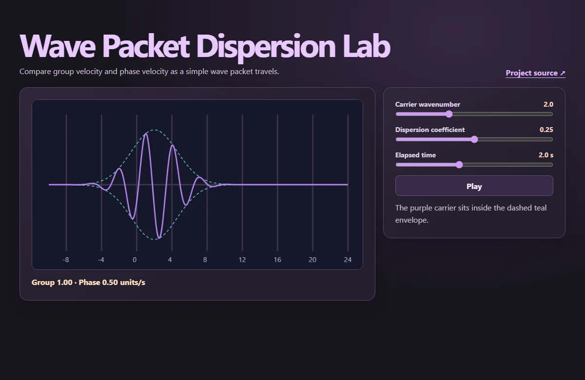

# Wave Packet Dispersion Lab

Compare group velocity and phase velocity as a simple wave packet travels.

[Open the browser app](https://surfingcoder.com/apps/wave-packet-dispersion-lab/)

## Run locally

Run the following command in this repository and open [localhost:8000](http://localhost:8000).

    python -m http.server 8000

The demo uses a quadratic dispersion relation, ω = Dk². The carrier speed is Dk and the envelope speed is 2Dk. It is a narrowband illustration with a fixed envelope width.

## Verify

Run the following command with Node.js 22 or newer.

    node --test
